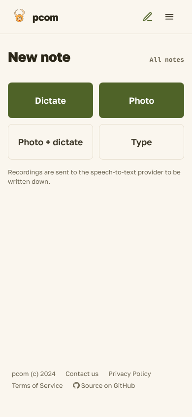
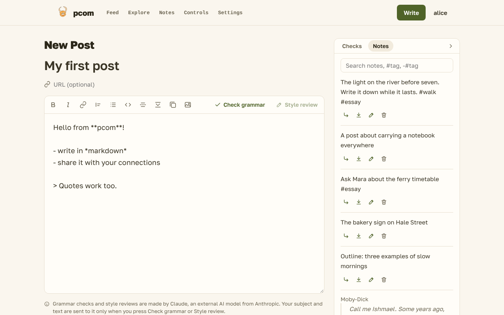

# Notes

Notes are private snippets you keep for later posts: a thought on a walk, a passage from a book, a photo of a
page, a memo you dictated. Only you can see them. You capture them in a few taps, sort them with tags and
sources, and put them into a post from the post editor.

## Capturing a note

Open **Capture** in the Notes section of the Controls page, or go to `/controls/notes/new`, to get the capture
page (**Notes** in the top bar opens the list). On a phone it is the page to keep open or to install (see [Notes on a phone](notes-on-a-phone.md)).

- **Dictate** records a memo. Press **Stop** when you are done: stopping saves it. The screen stays on while you
  record, because a phone's browser stops recording when the screen goes dark.
- **Photo** takes a picture with the camera, and saves it as a note. **Photo + dictate** takes the picture and
  records a voice caption into the same note.
- **Type** opens a box for the text. **Save note** saves it.

There is no Save step for the others and no prompt for tags: a capture is a note as soon as it is made. Tags, text
and cleanup can wait until you sort your notes. Dictate is shown only when the site has a speech-to-text
provider; without one, Photo and Type still work.

Add `?start=voice` or `?start=photo` to the address to start a mode as the page opens (the installed app's
shortcuts do this). Where the browser does not let a recording start without a tap, the page shows one big
button instead.

**Saved on the phone.** A capture is written to the phone first. With a poor connection the page says **Saved on
the phone, uploading…** and changes to **Saved** once the server has it; the capture keeps the time it was made,
not the time it arrived, so your list stays in the order things happened.

**Last capture.** The card under the buttons shows the last capture and its status. **Delete** removes it, also
while it is still waiting to upload. The capture page's photos are scaled down on the phone before upload, which
keeps them quick to send.

**Focus.** A focus is one tag that every new note gets, for a project you are writing. Choose one from the tags
under **Tags and sources** (its **focus** button); the list then shows **Now writing: #essay** with a **Stop**
link, and the capture page shows the *#essay* chip with a **Stop** button. The focus ends on its own when no capture has been made under it for twelve hours by default.

## The list

**Notes** lists your notes, newest first, with a box at the top to jot one down (Ctrl+Enter saves it). Under the
box are:

- **Views.** **Inbox** shows the notes with no tag yet. **Unused** shows the notes you have not put into a post.
- **Sources**, when you have quotes: a book or article, with the number of its notes. Selecting one shows only its
  notes.
- **Search**, which looks through the text of your notes.
- **Tags**, the tag bar. Each chip is a tag with its count, most used first. A tap on a chip cycles it through
  *include* (the notes must have it), *exclude* (they must not have it) and off. The filters are in the address, so
  a filtered view can be bookmarked.

A tag can be **hidden**: its notes leave the list, for tags like *done* or a project that is finished. **hide** is on
each chip. **Show hidden (N)** brings them back for one view, and **Leave hidden out** hides them again.

Notes captured close together form a **stack**, labelled with the day and the part of it, such as
"Tuesday evening, 7 notes". A stack is one group in the list. Its heading opens the stack by itself, and selecting
the stack selects all its notes.

Each note shows its text, its tags, its source, and whether it has been used in a post. **Edit** opens the note,
and **Delete** removes it, after you confirm.

### Tags

Tags are free words. You can set them in four ways:

- **A suggestion.** Each untagged note offers up to three of your existing tags whose words appear in its text,
  or that other notes from its source or stack carry. One tap tags the note.
- **`#word` in the text.** Any `#word` in a note is a tag, so there is no tag field to fill. Editing the text edits
  the tag, and its chip says *(written in the text)*. To remove that tag, remove the `#word` from the text.
- **Selection.** Select several notes, or a stack, and press **Tag** to add tags to all of them.
- **Speech.** Say "hashtag word" while dictating and the transcript writes `#word`.

**Tags and sources** (the link at the top of the list) is where tags and sources are renamed and merged, since
free-form words drift. Renaming or merging a tag changes it on every note that has it. The same screen hides and
unhides tags, and sets the focus.

### Several notes at once

Tick the boxes of several notes, or of a stack, and a bar appears with **Tag**, **Source** and **Delete**. **Source**
gives the selected notes one book or article, and an empty title clears it. **Delete** asks first and says how many
notes and recordings it removes.

## Quotes

A quote is a note with a source: the passage of a book, or an article, and the page or location if you give one.

- **Share a passage** from the Kindle app, your reader or a text app to pcom. The text arrives as it was selected,
  with no title or author, so pcom stores it as a quote: a blockquote, with a link kept as a link.
- **A share can't set tags or a source.** Its tags are the `#words` in its text, and its source comes as for any
  quote.
- **Type or paste** a passage on the capture page. It is stored as typed.
- **The source** of a quote is the source of the quote before it, if that was within the focus time. Otherwise
  the quote waits in the Inbox, and one tap from the recent sources gives it a source. A plain note or a photo can
  be given a source the same way.
- **Sources** need no setup. Quotes from one book land in one group, found by its title and author. Sources can be
  renamed or merged on **Tags and sources**, for the rare share that spells a title differently.

A photo of a page stays with its quote, so you can check the recognized text against it. The text is editable like
any other.

## Voice notes

A recording is written down by a speech-to-text service that the site uses. The capture page and the editor say
so next to the record button: a recording is sent to that service, and nothing else of the note is.

- A note with a recording shows **Transcribing…** while it waits, then its text appears in place. The text is the
  note's text, and you can edit it like any note. Only the recording is kept as the original.
- If the text could not be made, the note says **Transcription failed — try again.** and the note keeps its
  recording.
- The language is detected for each recording. Nothing is set in advance, so a memo in another language comes out
  right.
- A very short or mixed-language memo can come out in the wrong language. **Transcribe again as…** on the note
  (in the list or on its edit page) sends the recording once more in the language you pick. It counts against the
  daily minutes, and since it replaces the note's text, it asks first when the note has text.
- The transcription minutes are limited per day. A limit reached says so; the minutes count over the last 24 hours.
- A recording is at most ten minutes long by default.

## Deleting

**Delete** removes a note for good. The confirmation says what goes: the note, its recording and its photos.
There is no trash. The text you inserted into a post stays there. Photos of a deleted note are unlinked from it,
but their files stay on the server, as the images of deleted posts do.

## Using notes in a post

In the post editor, the **Notes** button in the toolbar opens a panel beside the text. It has the same tags, search,
sources and stacks as the list. Each note shows **Insert** (at the cursor), **Append** (at the end of the post) and
**Open** (the note in a new tab). A quote goes in with its attribution, such as *— Author, *Title*, p. 12*. A note
that you insert is marked as used, so the **Unused** view shows what is left.

The text is copied into the post; the note stays as it is. Changing the post later does not change the note.
