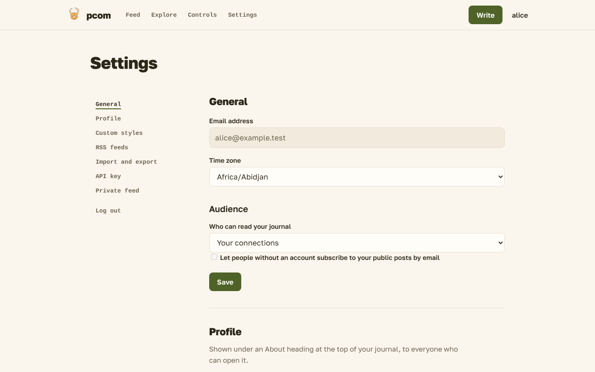
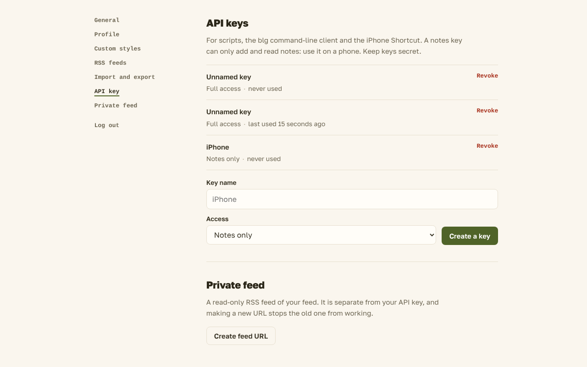

# Settings

Settings is where you manage your account: your audience, invitations, feeds, API key and a backup of your posts. Open it from the Settings link in the header menu.

## General

You can see your email address and set your time zone, which decides how times are shown to you.

## Audience

Choose who can read your journal: your connections, anyone with a pcom account, or anyone on the internet. What each
option means for your posts is in [Connections](connections.md).

Under "Anyone on the internet" one line says what that means: your journal and public posts appear on pcom's front
page and public RSS feed, and you can let people subscribe by email. Below it, the checkbox "Let people without an
account subscribe to your public posts by email" is enabled only for that option. Leave it off, and nobody can
subscribe. Turn it on, and people can subscribe to your public posts, and you see their addresses on your
[controls page](subscriptions.md).

If you have subscribers, a warning appears when you switch the checkbox off or choose a narrower audience: "N people
subscribed by email won't get your posts while your journal isn't open to anyone on the internet or email
subscriptions are off." Their subscriptions are kept, and they start getting your posts again when you open the
journal and turn the checkbox on. Subscribers are not told. See [Subscriptions](subscriptions.md).

## Invitations

Pcom grows by invitation. This section appears only while you have unused or sent invitations, and shows how many are left and to whom you sent the others. Send one to an email address and the recipient gets a link to create an account, connected to you. See [Connections](connections.md).

## Feeds and private feed

Add the URL of an RSS feed to follow it in your [feed](feed.md), and remove it again. The page also creates a private RSS feed of your pcom feed and lets you replace its address.

## Public profile

Write a short text about yourself, in markdown. It appears under an "About" heading at the top of your journal, for everyone who can open your journal (see [Connections](connections.md)). It can be up to 6,000 characters; leave it empty to remove it.

## Styles

You can add your own CSS, which is applied to your journal, your single-post pages, and your own feed and Explore pages.

The `us-*` classes are the stable contract for your CSS; every other class may change when pcom's design changes. Each hook marks one element:

| Class | Marks |
|---|---|
| `us-user-home` | the whole page of a journal, a feed or Explore |
| `us-user-header` | the page heading |
| `us-profile-about` | the "About" text of a journal |
| `us-feed-post` | one post in a list |
| `us-feed-post-stats` | the row of actions under a post in a list |
| `us-feed-comment` | one comment in a feed |
| `us-feed-rss-item` | one item of an RSS feed in your feed |
| `us-post-date` | the date of a post or item |
| `us-load-more` | the "load more" control at the end of a list |
| `us-single-post` | the whole page of a single post |
| `us-post-header` | the title of a single post |
| `us-post-body` | the text of a single post |
| `us-public-link` | the public-link line of a shared post ("Anyone with the link can read this post", with Open link, Copy link and Turn off) |
| `us-comment-stats` | the row of actions under a post, above its comments |
| `us-comments-section` | the comments of a single post |
| `us-single-comment` | one comment of a single post |
| `us-comment-form` | the form for writing a comment |

## Import and export

Export downloads all your posts with their images as a zip file; import reads such a file back, into the same or another account. Importing into the same account updates the posts you already own and skips images already uploaded under the same name; importing into another account creates new copies.

## API keys

Make API keys for scripts, the [blg](api.md) command-line client and the iPhone Shortcut. You can have several. Give each a name, and choose its access:

- **Full access** opens the whole [API](api.md).
- **Notes only** can create and list your notes and nothing else. Use it for a phone: a key stored on a phone can't change or delete anything.

Each key in the list shows its name, its access and when it was last used. **Revoke** stops a key working at once, and asks first.

The key is shown once, right after you create it: copy it then. pcom stores only a hash of it, so afterwards Settings can't show it again. A key stays the same until you revoke it; keep it secret.

