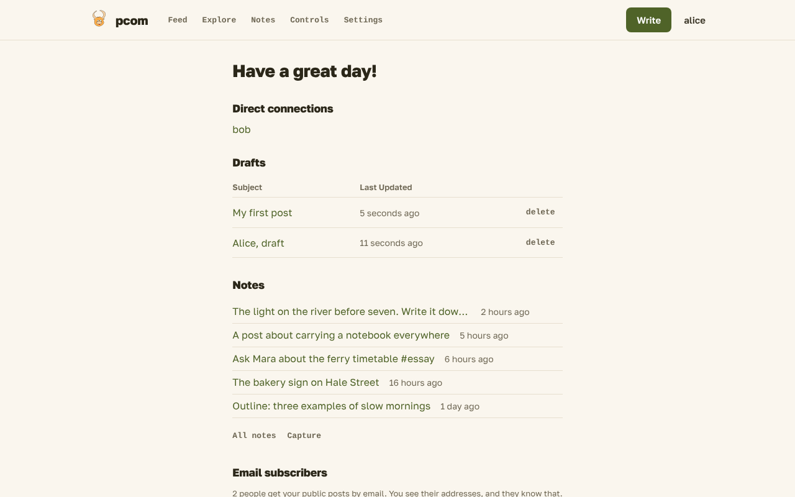
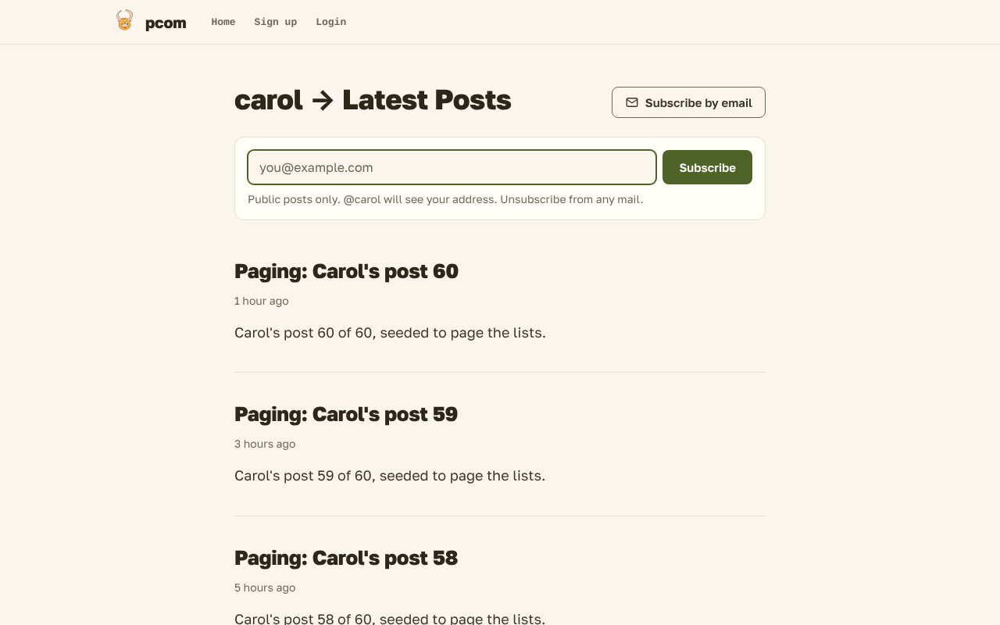
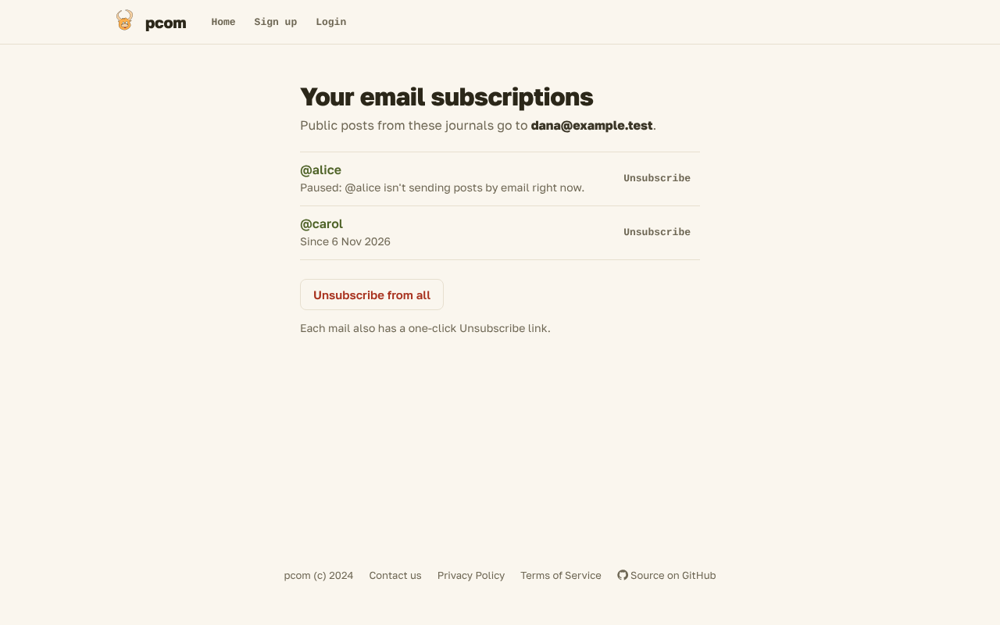

# Email subscriptions

Someone without a pcom account can get your public posts by email. They subscribe on your journal or on a public
post, confirm the address from a mail, and get each new post you choose to send them. You turn this on yourself, under
[Audience](settings.md#audience) in Settings.

## For authors

Turn on "Let people without an account subscribe to your public posts by email" under Audience, with your journal set
to "Anyone on the internet". Until then nobody can subscribe, and the subscribe form is hidden.

Your subscribers are on your Controls page, under "Email subscribers":

The page shows how many people subscribe, and each confirmed address with the date it subscribed. Each row has a
Remove button, which asks first. A removed subscriber gets no mail about it, and you get none either. Pending
subscriptions, which the reader has not confirmed yet, are not counted or listed.

You see their addresses, and they know it: the subscribe form and the confirmation page say so.

You get a mail when someone confirms a subscription, and when a subscriber unsubscribes. Both mails name the address.

When you publish a public post, the post form offers "Email this post to N subscribers", checked on a first publish.
Each post is mailed to subscribers at most once. Republishing it, or making a published post public again, does not
mail it a second time. Autosaving never mails anybody. Mails to your connections are not affected.

The post form also says "and your N email subscribers" beside the Public option, while subscriptions are possible.

If you turn the setting off, or choose a narrower audience, while people are subscribed, Settings warns you first.
Their subscriptions are kept, but nothing is mailed to them until you open your journal again and turn the setting on.
Anyone who confirms a subscription while you are paused is still added, and you are still told about it.

## For readers

When you aren't logged in, a "Subscribe by email" button sits beside the title of the journal of an author who takes
subscriptions. It opens a small form under the title, and each public post of that author ends with the same form. Enter your
address and press Subscribe. The button says "Checking…" for a moment while your browser does a small check that stops
bots, so subscribing needs JavaScript. The form is then replaced by "Check your inbox: we sent a confirmation link."

The mail asks you to confirm. Follow the link and press Confirm subscription. Opening the link changes nothing by
itself, so a mail scanner that opens it does not subscribe you. A link that has expired, or is unknown, says "This
link has expired" and asks you to subscribe again from the author's journal.

Each new post mail has a footer that says you subscribed to the author's public posts at pcom, and links to manage the
subscription and to unsubscribe. Your mail client may also show its own Unsubscribe button on that mail, which ends
that one subscription at once.

The manage page lists every author you follow by email, and marks any that aren't sending posts right now. You can
unsubscribe from one author, or from all of them. Both ask first.

If you have lost the link, open "Your email subscriptions" at `/subscriptions`, enter your address, and pcom mails you
the link if the address subscribes to anyone. The page gives the same answer whether or not it does.

Subscriptions use your address only to send you mail and show it to the author. Accounts and invitations are described
in [Connections](connections.md). The privacy policy says what pcom keeps about an address that has no account.
